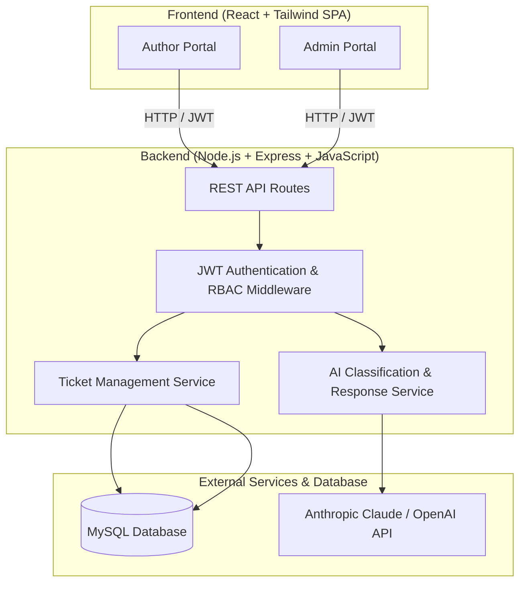

# Architecture Documentation — BookLeaf Author Support & Communication Portal

## 1. System Overview
The BookLeaf Author Support & Communication Portal is a full-stack web application designed to streamline author support operations at BookLeaf Publishing. It consists of two primary interfaces:
- **Author Portal:** For authors to manage books, view royalties/sales, submit support queries, and track tickets with near-real-time responses.
- **Admin Portal:** For internal ops teams to manage incoming tickets, utilize AI auto-classification and priority scoring, review AI-drafted responses backed by the BookLeaf Knowledge Base, update ticket status, add internal notes, and assign tickets.

## 2. Technology Stack
- **Frontend:** React (Vite) + Tailwind CSS + Lucide Icons + React Router.
- **Backend:** Node.js, Express.js, JavaScript (ES Modules).
- **Database & Driver:** MySQL, `mysql2` (Parameterized Async SQL queries).
- **AI Integration:** Anthropic Claude / OpenAI API with Knowledge Base context injection.

## 3. High-Level Architecture Diagram

## 4. Security & Data Flow
1. **Authentication:** Stateless JWT issued upon email/password login. Stored in client localStorage and sent via `Authorization: Bearer <token>` header.
2. **Authorization (RBAC):** Middleware validates user role (`author` or `admin`). Authors can only access their own profile, books, and tickets. Admins have global access.
3. **AI Guardrails & Graceful Degradation:** AI calls are wrapped in robust error handling. If the LLM service is down or rate-limited, tickets are still created with default fallback classification and priority, and admins can draft manual responses.
