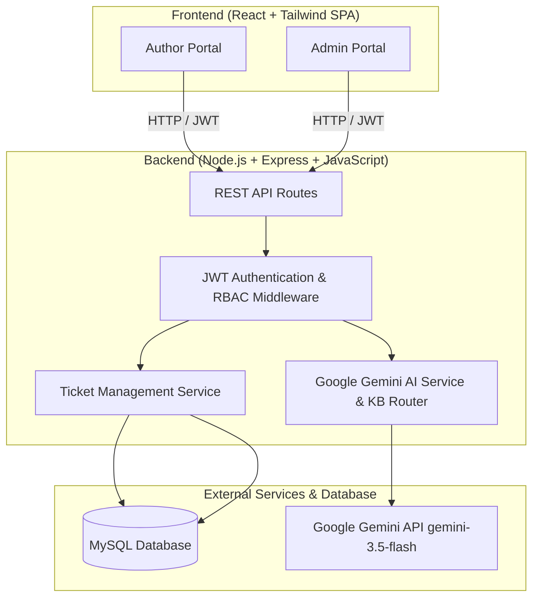

# Architecture Documentation — BookLeaf Author Support & Communication Portal

## 1. System Overview
The BookLeaf Author Support & Communication Portal is a full-stack web application designed to streamline author support operations at BookLeaf Publishing. It consists of two primary interfaces:
- **Author Portal:** For authors to manage books, view royalties/sales, submit support queries, and track tickets with near-real-time responses.
- **Admin Portal:** For internal ops teams to manage incoming tickets, utilize AI auto-classification and priority scoring, review AI-drafted responses backed by the BookLeaf Knowledge Base, update ticket status, add internal notes, and assign tickets.

## 2. Technology Stack
- **Frontend:** React (Vite) + Tailwind CSS + Lucide Icons + React Router.
- **Backend:** Node.js, Express.js, JavaScript (ES Modules).
- **Database & Driver:** MySQL, `mysql2` (Parameterized Async SQL queries).
- **AI Integration:** Google Gemini (`gemini-3.5-flash`) via official `@google/genai` SDK with strict Knowledge Base injection and graceful degradation fallback.

## 3. High-Level Architecture Diagram


## 4. Security, AI Integration & Data Flow
1. **Authentication:** Stateless JWT issued upon email/password login. Stored in client localStorage and sent via `Authorization: Bearer <token>` header.
2. **Authorization (RBAC):** Middleware validates user role (`author` or `admin`). Authors can only access their own profile, books, and tickets. Admins have global access.
3. **AI Service & Knowledge Base Integration (`aiService.js`, `bookleafKB.js`, `ticketContextService.js`):**
   - Utilizes Google Gen AI SDK (`@google/genai`) with model `gemini-3.5-flash`.
   - **Scoring-Based KB Retrieval (`bookleafKB.js`):** `getKBSectionForQuery()` calculates relevance scores using regex phrase matching, weighted keywords (+4 high-priority, +3 phrases, +2 words), category alignment boosts (+6), and filters to top-3 sections, always including `communicationGuidelines`.
   - **Category-Specific Database Context (`ticketContextService.js`):** `fetchAndBuildAuthorContext()` prepares structured data (specific book or catalog aggregate) and `selectAuthorContext()` filters only relevant fields (e.g., `royaltyAggregate` for royalty tickets, `distributionHealth` for distribution tickets). This prevents irrelevant data from being passed to Gemini.
   - **Safe Financial Formatting (`aiService.js`):** `formatCurrency()` treats missing values as "Not available" (never zero). `buildAuthorDbSnippet()` constructs organized context blocks with anti-hallucination instructions.
   - **Ticket Auto-Classification & Summarization:** Automatically categorizes incoming queries, scores priority, and generates `ai_summary`. Includes graceful fallback using rule-based classifier.
   - **Context-Aware Response Drafting:** Admin endpoint injects KB policies + organized author DB records (sales, royalties, production stages, ISBN) to draft empathetic, accurate replies.
4. **Graceful Degradation:**
   - If the LLM API fails, times out (>8s), hits rate limits, or API key is unconfigured, the system logs the warning and falls back to a robust rule-based intelligent classifier.
   - **Important:** Ticket creation **succeeds** regardless of LLM availability, preventing author support disruption.

## 5. Project Folder Structure
```text
bookleaf/
├── backend/
│   ├── src/
│   │   ├── config/          # Database configuration (pool.js)
│   │   ├── controllers/     # Route business logic (auth, author, ticket)
│   │   ├── knowledgeBase/   # BookLeaf KB policies and guidelines
│   │   ├── middleware/      # JWT verification & RBAC middleware
│   │   ├── routes/          # Express API route definitions
│   │   ├── services/        # AI service (Gemini) & context builder services
│   │   ├── server.js        # Express app entry point
│   │   └── seed.js          # Database seeder script
│   └── package.json
├── frontend/
│   ├── public/              # Static assets & favicons
│   ├── src/
│   │   ├── components/      # React components (AuthorPortal, AdminPortal, Modals)
│   │   ├── App.jsx          # Main root component & routing state
│   │   ├── main.jsx         # React DOM mount point
│   │   └── index.css        # Tailwind CSS imports & custom styles
│   └── package.json
└── docs/                    # Architecture, API & optimization documentation
```

## 6. System Data Flow
1. **Author Ticket Creation & AI Auto-Classification Flow:**
   - Author submits support query with subject, description, and optional book ID.
   - Backend verifies book ownership, then calls **Google Gemini (`gemini-3.5-flash`)** with the query and Knowledge Base context.
   - Gemini returns automated category, priority score, and summary (with rule-based graceful fallback if offline).
   - Ticket and initial message are saved in MySQL transactionally; response returns to frontend with a 201 Created status.

2. **Real-Time Polling & Unread Notification Dot Flow:**
   - Client components (`AuthorPortal`, `TicketDetailModal`) poll backend endpoints via non-overlapping recursive `setTimeout` (6-second polling interval).
   - `AuthorPortal` fetches `/api/tickets` which evaluates `is_unread` (checking if `author_last_viewed_at` is older than the latest admin message timestamp).
   - If unread, a green notification dot (`bg-teal-600`) appears on the ticket item and Support Tickets tab badge.
   - When the author clicks and opens the ticket (`getTicketById`), backend updates `author_last_viewed_at = NOW()`, instantly clearing the unread status on subsequent polls.

## 7. Known Limitations & Future Improvements
- **File Attachments:** Allow authors to upload PDFs, documents, and images with tickets and replies.
- **Real-time Communication:** Replace polling with WebSockets or Server-Sent Events for instant message delivery and status updates.
- **AI Monitoring:** Add token usage tracking, response quality evaluation, and cost monitoring for Google Gemini API calls.
- **Performance:** Optimise database queries and introduce Redis caching where appropriate for high-volume catalogs.
- **Security:** Strengthen token storage, input validation, rate limiting, and file access controls.
- **Scalability:** Introduce background job queues (e.g., BullMQ) for email notifications and other time-consuming operations.

