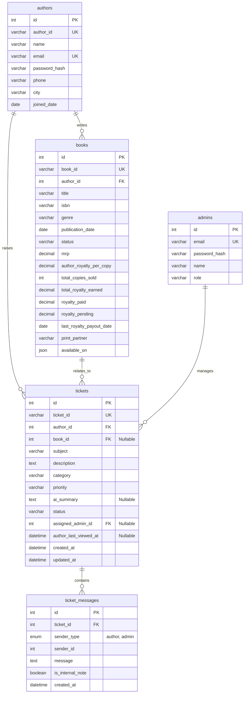

# Database Schema — BookLeaf Portal

## Database Engine: MySQL (v8.0+)
Managed via native SQL migration scripts using `mysql2`.

## ER Diagram


## SQL Schema Definition (`schema.sql`)
```sql
CREATE DATABASE IF NOT EXISTS bookleaf_db;
USE bookleaf_db;

CREATE TABLE IF NOT EXISTS authors (
    id INT AUTO_INCREMENT PRIMARY KEY,
    author_id VARCHAR(50) UNIQUE NOT NULL,
    name VARCHAR(100) NOT NULL,
    email VARCHAR(150) UNIQUE NOT NULL,
    password_hash VARCHAR(255) NOT NULL,
    phone VARCHAR(30),
    city VARCHAR(100),
    joined_date DATE,
    created_at TIMESTAMP DEFAULT CURRENT_TIMESTAMP
);

CREATE TABLE IF NOT EXISTS books (
    id INT AUTO_INCREMENT PRIMARY KEY,
    book_id VARCHAR(50) UNIQUE NOT NULL,
    author_id INT NOT NULL,
    title VARCHAR(255) NOT NULL,
    isbn VARCHAR(50),
    genre VARCHAR(100),
    publication_date DATE NULL,
    status VARCHAR(100) NOT NULL,
    mrp DECIMAL(10, 2) NULL,
    author_royalty_per_copy DECIMAL(10, 2) NULL,
    total_copies_sold INT DEFAULT 0,
    total_royalty_earned DECIMAL(10, 2) DEFAULT 0.00,
    royalty_paid DECIMAL(10, 2) DEFAULT 0.00,
    royalty_pending DECIMAL(10, 2) DEFAULT 0.00,
    last_royalty_payout_date DATE NULL,
    print_partner VARCHAR(100) NULL,
    available_on JSON NULL,
    FOREIGN KEY (author_id) REFERENCES authors(id) ON DELETE CASCADE
);

CREATE TABLE IF NOT EXISTS admins (
    id INT AUTO_INCREMENT PRIMARY KEY,
    email VARCHAR(150) UNIQUE NOT NULL,
    password_hash VARCHAR(255) NOT NULL,
    name VARCHAR(100) NOT NULL,
    role VARCHAR(50) DEFAULT 'admin',
    created_at TIMESTAMP DEFAULT CURRENT_TIMESTAMP
);

CREATE TABLE IF NOT EXISTS tickets (
    id INT AUTO_INCREMENT PRIMARY KEY,
    ticket_id VARCHAR(50) UNIQUE NOT NULL,
    author_id INT NOT NULL,
    book_id INT NULL,
    subject VARCHAR(255) NOT NULL,
    description TEXT NOT NULL,
    category VARCHAR(100) DEFAULT 'General Inquiry',
    priority VARCHAR(50) DEFAULT 'Medium',
    ai_summary TEXT NULL,
    status VARCHAR(50) DEFAULT 'Open',
    assigned_admin_id INT NULL,
    author_last_viewed_at TIMESTAMP NULL,
    created_at TIMESTAMP DEFAULT CURRENT_TIMESTAMP,
    updated_at TIMESTAMP DEFAULT CURRENT_TIMESTAMP ON UPDATE CURRENT_TIMESTAMP,
    FOREIGN KEY (author_id) REFERENCES authors(id) ON DELETE CASCADE,
    FOREIGN KEY (book_id) REFERENCES books(id) ON DELETE SET NULL,
    FOREIGN KEY (assigned_admin_id) REFERENCES admins(id) ON DELETE SET NULL
);

CREATE TABLE IF NOT EXISTS ticket_messages (
    id INT AUTO_INCREMENT PRIMARY KEY,
    ticket_id INT NOT NULL,
    sender_type ENUM('author', 'admin') NOT NULL,
    sender_id INT NOT NULL,
    message TEXT NOT NULL,
    is_internal_note BOOLEAN DEFAULT FALSE,
    created_at TIMESTAMP DEFAULT CURRENT_TIMESTAMP,
    FOREIGN KEY (ticket_id) REFERENCES tickets(id) ON DELETE CASCADE
);
```
